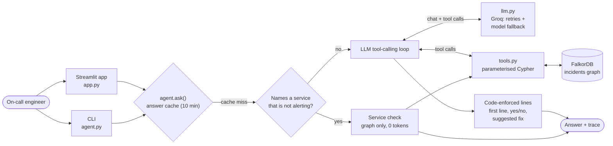
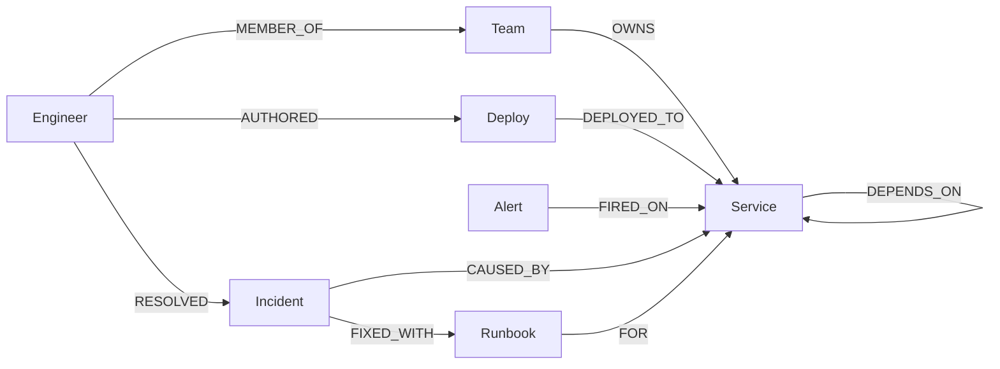

# RootCause Agent

An AI on-call agent that finds the **real** root cause of an outage by traversing a
FalkorDB dependency graph. It then shows the evidence path and the blast radius, tells you
who to wake up and what fixed this last time, and opens an incident.

Built for **Graph Hacks: Context for AI Agents** (WeMakeDevs × FalkorDB).
Track 1: *Agents That Act on Connected Data*.

- **Demo video:** `<!-- TODO: add demo video link -->`
- **Live app:** `<!-- TODO: add deployment URL -->`
- **Repository:** `<!-- TODO: add public repo URL -->`

---

## The problem

At 2 AM, seven alerts fire at once: the frontend says "Orders failing", the API gateway shows
5xx errors, checkout is erroring, payment and cart are slow, cache latency is high and
recommendation has high CPU. The loudest alerts are symptoms. The actual cause is a quiet
`warning` on the cache, triggered by a config change deployed 11 minutes earlier.

Finding that by reading alerts and searching documents is slow. The answer is in the
**connections**: which services depend on which, who deployed what and when, who owns what,
and what fixed this last time. That is a graph problem.

## What the agent does

Ask a question in plain English (for example, *"Checkout is failing. What's the root cause
and who do I wake up?"*). The agent:

1. Reads the alerts that are firing (FalkorDB).
2. Finds the root cause by traversing `DEPENDS_ON`. An alerting service is a **victim** if
   something it depends on is also alerting; the remaining candidates are ranked by how many
   alerting services depend on them, then by whether they had a recent deploy.
3. Shows the **evidence path** (shortest dependency chain from the symptom to the cause).
4. Computes the **blast radius** (everything upstream of the cause, most critical tier first).
5. Finds **who to contact**: owner team, author of the recent deploy, whoever fixed a similar
   incident before.
6. Finds the **past fix** (the runbook used on a similar past incident).
7. **Acts**: opens an incident in the graph (deduplicated: one open incident per service).
8. Explains the **red herring** (recommendation is alerting too, but explains fewer alerts
   and has no recent deploy).

If you ask about a service that is **not** alerting (*"auth is not working, who is
responsible?"*), the agent does not blame the current outage. It switches to a **service
check**: owners, dependencies, whether the service depends on the current root cause, and a
"may be a monitoring gap" hint. This is answered entirely from the graph, with 0 LLM tokens
and no incident opened.

A real answer (outage mode, `gpt-oss-20b`, question *"Checkout is failing. What's the root
cause and who do I wake up?"*):

```
cache is the root cause: D-1 (Config change: maxmemory lowered) by Arjun.
Root cause: cache (D-1: Config change: maxmemory lowered, by Arjun)
Evidence path: checkout → cart → cache
Blast radius: api-gateway, cart, checkout, frontend, payment
Contact: Priya (Platform team, resolved similar incident INC-101), Arjun (Platform team, authored deploy D-1)
Suggested fix: Roll back cache config (used in INC-101, resolved by Priya)
Incident: INC-201
Red herring: recommendation (explains only api-gateway and frontend, not checkout)
```

## Why FalkorDB does the real work

Without the graph there is no product. Every fact in the answer comes from a Cypher query:

| Question the agent must answer | How the graph answers it |
|---|---|
| Is this alert a cause or a symptom? | Variable-length `DEPENDS_ON*1..` traversal downstream of each alerting service |
| How many alerts does a candidate explain? | `DEPENDS_ON*1..` traversal upstream, intersected with the alerting set |
| How does the symptom connect to the cause? | `shortestPath((a)-[:DEPENDS_ON*]->(b))` |
| What breaks if it fails? | Upstream traversal, ordered by service tier |
| Who changed it, who owns it, who fixed it before? | `AUTHORED`/`DEPLOYED_TO`, `MEMBER_OF`/`OWNS`, `RESOLVED`/`FIXED_WITH` hops |
| Take action | `CREATE (:Incident)-[:CAUSED_BY]->(:Service)` |

The LLM (via Groq) decides which tools to call and phrases the answer. It never invents the
facts: the key lines (first line, yes/no verdict, suggested fix, and the whole service-check
answer) are checked or rewritten in code from the tool results.

## Architecture



The LLM chooses which tools to call and writes the explanation. The facts (root cause, path,
blast radius, people, runbook, incident ID) come from FalkorDB through `tools.py`, and the
lines that matter most are rebuilt from those results in code before the answer is shown.

---

## Graph data model



| Node | Properties | Count |
|---|---|---|
| `Service` | `name`, `tier` (1 = most critical) | 25 |
| `Team` | `name` | 6 |
| `Engineer` | `name` | 9 |
| `Deploy` | `id`, `change`, `time` | 5 |
| `Alert` | `id`, `message`, `severity`, `fired_at`, `status` | 7 |
| `Incident` | `id`, `title`, `status` (+ `summary`, `opened_at` for incidents the agent opens) | 3 past |
| `Runbook` | `title` | 3 |

| Relationship | Direction | Count |
|---|---|---|
| `DEPENDS_ON` | caller → callee | 39 |
| `OWNS` | Team → Service | 25 |
| `MEMBER_OF` | Engineer → Team | 9 |
| `FIRED_ON` | Alert → Service | 7 |
| `DEPLOYED_TO` | Deploy → Service | 5 |
| `AUTHORED` | Engineer → Deploy | 5 |
| `CAUSED_BY` | Incident → Service | 3 |
| `RESOLVED` | Engineer → Incident | 3 |
| `FIXED_WITH` | Incident → Runbook | 3 |
| `FOR` | Runbook → Service | 3 |

The services model an online shop (frontend, API gateway, checkout, cart, payment, catalog,
search, recommendation, shipping, …) on top of shared infrastructure (cache, postgres, kafka,
elasticsearch). All data is **synthetic**, defined in [`load_data.py`](load_data.py).
`load_data.py` validates the data before loading (no unknown services, exactly one owner per
service, …) and uses `MERGE`, so re-running it is idempotent.

### The scenario

| Time | Event |
|---|---|
| 1:50 AM | **D-1**: Arjun deploys "Config change: maxmemory lowered" to **cache** (the real cause) |
| 1:35 AM | D-5: Rohan deploys "Index mapping update" to search (recent, but search isn't alerting) |
| 1:40 AM | A-7: recommendation "High CPU" (warning), an unrelated alert, the red herring |
| 1:55 AM | A-6: cache "Cache latency high" (warning) |
| 1:57 to 2:01 AM | cart slow → payment slow → checkout errors → api-gateway 5xx → frontend "Orders failing" |

Older deploys (D-2 recommendation, D-3 frontend, D-4 shipping) fall outside the 30-minute
"recent" window. Past incident **INC-101** ("Cache eviction storm after config change") was
resolved by Priya with the runbook **"Roll back cache config"**.

### Demo clock: `NOW = 121`

Times are stored as **minutes after midnight**, and the scenario is frozen at
`NOW = 121` (2:01 AM, when the last alert fired), set in [`tools.py`](tools.py). "Recent
deploy" means `time >= NOW - 30`. Against the real wall clock, the synthetic deploys would be
hours old and the scenario would stop working, so the clock is fixed on purpose. This keeps
the demo reproducible for anyone who runs it.

---

## The Cypher queries

Every Cypher query the product runs, each with one line on what it answers, is in
**[queries.md](queries.md)**. All of them are parameterised, so no user input is ever
concatenated into Cypher.

---

## Setup

Requirements: Python 3.10+, a free [Groq](https://console.groq.com) API key, and FalkorDB
(either local Docker or FalkorDB Cloud).

```bash
# 1. Install
git clone <!-- TODO: repo URL --> rootcause-agent
cd rootcause-agent
python -m venv venv && source venv/bin/activate
pip install -r requirements.txt

# 2. Configure
cp .env.example .env        # then put your GROQ_API_KEY in .env
```

**3a. FalkorDB with local Docker.** The defaults in `.env.example` already point here.

```bash
# graph on 6379, FalkorDB browser on http://localhost:3000
docker run -d --name falkordb -p 6379:6379 -p 3000:3000 falkordb/falkordb:latest
```

**3b. FalkorDB Cloud.** Create a free instance at [app.falkordb.cloud](https://app.falkordb.cloud),
then copy its host, port, username and password into `.env`:

```bash
FALKORDB_HOST=<your-instance-host>
FALKORDB_PORT=<your-instance-port>
FALKORDB_USERNAME=<username>
FALKORDB_PASSWORD=<password>
```

The client connects without TLS, which is what the free tier offers (see
[Limitations](#limitations)).

```bash
# 4. Load the graph (validates the data, then MERGEs it; prints node/edge counts)
python load_data.py --reset
```

### Configuration

| Variable | Default | Purpose |
|---|---|---|
| `GROQ_API_KEY` | (required) | Groq API key |
| `MODELS` | `openai/gpt-oss-120b,openai/gpt-oss-20b,qwen/qwen3.8-27b` | Model fallback chain: when one model's daily quota is used up, the next one is used |
| `FALKORDB_HOST` / `FALKORDB_PORT` | `localhost` / `6379` | FalkorDB connection |
| `FALKORDB_USERNAME` / `FALKORDB_PASSWORD` | (empty) | For FalkorDB Cloud |
| `FALKORDB_GRAPH` | `incidents` | Graph name |

For a Streamlit deployment, the same keys can go in `.streamlit/secrets.toml` (git-ignored).

---

## Running it

```bash
streamlit run app.py                                     # the web app (http://localhost:8501)
python agent.py "Orders are failing. What is going on?"  # one question, CLI
python agent.py                                          # interactive CLI ('reset' clears incidents)
python tools.py                                          # run the graph tools only, no LLM
```

**The web app** shows active alerts, the dependency graph (root cause in red, evidence path
in bold red, blast radius in orange, red herring dashed), the diagnosis (root cause and
deploy, evidence path, who to wake up, suggested fix, what was ruled out), the incident it
opened, the token cost of the run, the tools the agent called, and an optional side-by-side
comparison with the vector-RAG baseline. In service-check mode it shows only the asked
service's neighbourhood (dependencies and callers), with a toggle for the full graph.
**Reset demo** deletes open incidents and cached answers.

### Demo questions

| Question | What it shows |
|---|---|
| *Checkout is failing. What's the root cause and who do I wake up?* | Full investigation: cache, deploy D-1 by Arjun, evidence path, blast radius, contacts, runbook, incident opened |
| *What changed recently that caused this?* | The deploy and its author, from `AUTHORED`/`DEPLOYED_TO` |
| *What else breaks if cache goes down?* | Blast radius by upstream traversal, most critical tier first |
| *Is the recommendation service causing the outage?* | "No", decided from the graph: the red herring is ruled out |
| *Who should I wake up right now?* | Owners, the deploy author and the past resolver, each with a reason |
| *auth is not working. Who is responsible for that?* | Service check: auth isn't alerting, so owners and dependencies only, 0 tokens, no incident |
| *Is postgres healthy?* | Service check on shared infrastructure, with a monitoring-gap hint |

Press **Reset demo** between runs if you want the incident to be opened again rather than
reused.

---

## Graph agent vs. vector RAG

To check that the graph actually matters, [`baseline.py`](baseline.py) is a deliberately
**fair** vector-RAG baseline over the *same* data: every node and relationship turned into a
sentence, TF-IDF retrieval with stopwords and stemming, the current alerts added to the
search query, top-8 documents, same LLM. [`compare.py`](compare.py) asks both the same
questions and scores them against an answer key **read from the graph** (nothing hard-coded).

```bash
python load_data.py --reset && python compare.py   # writes compare_results.md (~4 min)
```

Results from the last full run:

| Question | Check | Graph agent | Vector RAG |
|---|---|---|---|
| What is going on? Orders are failing. | names root cause | ✅ | ✅ |
| What is going on? Orders are failing. | names what changed (deploy) | ✅ | ❌ |
| What is going on? Orders are failing. | takes action (opens incident) | ✅ | ❌ |
| What is going on? Orders are failing. | names the past fix (runbook) | ✅ | ❌ |
| What changed recently that caused this? | names the deploy | ✅ | ❌ |
| What changed recently that caused this? | names who made it | ✅ | ❌ |
| What else breaks if cache goes down? | lists full blast radius | ✅ | ❌ |
| Is the recommendation service causing the outage? | answers No | ✅ | ❌ |
| Is the recommendation service causing the outage? | points to the real root cause | ✅ | ❌ |
| Who should I wake up right now? | names the people to contact | ✅ | ❌ |
| Who should I wake up right now? | gives a reason (deploy / past fix) | ✅ | ❌ |
| **Total** | | **11/11** | **1/11** |

**What this does and doesn't show.** A fair RAG baseline *can* name cache: its retrieved
documents include "payment depends on cache" and "cart depends on cache", and it often says
the problem is "likely stemming from the cache". What it cannot do is follow the chain
further. It doesn't connect the cache to deploy D-1 and Arjun, it doesn't return the full
blast radius (that needs multi-hop traversal, not similar-looking sentences), it doesn't know
who to wake up and why, it can't rule out the red herring, and it can't act (open an
incident). In one run it also attributed the api-gateway 5xx alert to payment. Note that
some of the graph agent's lines are enforced in code from graph results (for example, the
"No" verdict for the red-herring question). That is a design choice, and part of what the
graph enables.

---

## Reliability: what is enforced in code

LLMs are good at choosing tools and phrasing answers, and bad at being reliably exact at
2 AM. So:

- **First line** must answer the question asked (root cause, contacts, blast radius). If the
  model's first line doesn't, one built from the tool results is put in front.
- **Yes/no verdicts** ("Is recommendation causing the outage?") are decided from the graph.
- **Suggested fix** is always the runbook from `find_similar_incidents`. If the model skipped
  that tool, the code calls it directly; an LLM-written runbook title is never kept.
- **Service check mode**: questions about a service that isn't alerting are answered fully in
  code (0 tokens), and no incident is created.
- **Required steps**: if the model tries to finish without an evidence path or an incident,
  it is nudged (up to 3 times). If it still returns nothing, an answer is assembled from the
  tool results and marked `fallback`.
- **One incident per outage**: guarded in the agent and deduplicated in the graph.
- **Groq free tier**: retries on rate limits (respecting `retry-after`), connection errors,
  5xx errors and malformed tool calls. Falls back to the next model when one model's daily
  quota is used up. Reasoning effort is set to low. A 10-minute answer cache (labelled
  `cached` in the UI) avoids repeat calls during a live demo.

## Tests

```bash
python agent.py --test               # all 7 tests
python agent.py --test --only=1,5,6  # a subset (saves tokens)
```

- Tests 1 to 4 (outage): root cause = cache, exactly one incident opened, the runbook title
  matches the graph, and the first line answers the question.
- Tests 5 to 7 (service check: *auth*, *postgres*, *accounting*): "no active alerts" on the
  first line, the owners from the graph are named, no incident is created, the root cause is
  not blamed for the named service, and no LLM call is made.

Expected values are read from the graph, not hard-coded. Approximate cost per question on
`gpt-oss-20b`: about 11k tokens for an outage investigation (about 9 LLM calls), 0 for a
service check.

---

## Limitations

- **Synthetic, static data.** One scripted outage on a frozen clock (`NOW = 121`). Alerts
  don't resolve, and there is no live telemetry ingestion.
- **Unknown services fall back to outage mode.** Service-check mode only triggers for
  service names that exist in the graph. A question about a service the graph doesn't know
  (*"Is billing down?"*) is answered as a normal outage investigation, so it reports the
  current cache outage instead of saying "unknown service".
- **The root cause must be alerting.** The rule finds the deepest *alerting* service. A
  silent failure (a service with no alert) won't be named as the cause. The service-check
  mode flags this as a possible monitoring gap instead.
- **Service names that are ordinary words** (`review`, `search`, `email`, `cart`, `cache`)
  are matched in the question. *"Can you review what's going on?"* is read as a question
  about the `review` service.
- **The outage-mode Contact line is written by the LLM.** It is based on
  `find_people_to_contact`, but unlike the suggested fix it is not yet rewritten in code, so
  a small fallback model can occasionally get names wrong.
- **Single-user demo state.** The incident guard and the answer cache are process-wide, so
  several people using one Streamlit instance at once share them.
- **Free-tier FalkorDB Cloud has no TLS.** The connection to the free instance is
  unencrypted (password-authenticated only). That is fine for synthetic demo data; real
  incident data would need a paid tier with TLS, and `ssl=True` on the client.
- **Groq free-tier quota.** Groq gives about 200k tokens per model per day, which is about 17
  outage investigations per model. When the quota is used up the next model in `MODELS` is
  tried; when all of them are used up, the agent stops with a "daily Groq quota used up"
  error until the quota resets. Service checks and cached answers use no tokens.
- **Restart after code changes.** Streamlit doesn't reliably reload `agent.py`, `tools.py` or
  `llm.py`. The app shows a warning banner when they have changed since it started.

## Project structure

| File | What it does |
|---|---|
| [`load_data.py`](load_data.py) | Synthetic dataset, validation, idempotent load (`--reset` to rebuild) |
| [`tools.py`](tools.py) | The graph tools (Cypher) and the root-cause rule |
| [`agent.py`](agent.py) | LLM tool-calling loop, code-enforced answer lines, service-check mode, tests, CLI |
| [`llm.py`](llm.py) | Groq wrapper: retries, model fallback chain, quota handling |
| [`app.py`](app.py) | Streamlit UI |
| [`baseline.py`](baseline.py) | Fair vector-RAG baseline (TF-IDF) |
| [`compare.py`](compare.py) | Scorecard: graph agent vs. RAG, answer key from the graph |
| [`compare_results.md`](compare_results.md) | Output of the last `compare.py` run |
| [`queries.md`](queries.md) | Every Cypher query the product runs, with what it answers |

## AI assistance disclosure

Claude (Anthropic), through Claude Code, was used to build the Streamlit UI
([`app.py`](app.py)), and to help with documentation: drafting parts of this README and also as a tutor for cypher and to gain the knowledge of falcorDB and also used to review my code to find any bugs.